# Cloud Security Monitoring with Splunk on AWS

A one-day personal project: build a small AWS environment, monitor it with Splunk using detections mapped to MITRE ATT&CK, analyse what the monitoring reveals, then remediate with Terraform and measure the improvement with Prowler.

**Stack:** AWS (CloudTrail, S3, IAM, EC2 security groups), Terraform, Splunk Enterprise (Docker), SPL, Prowler, jq, Bash.

## 1. Architecture


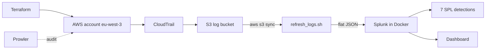

CloudTrail records every API call in the account to an S3 bucket. A script downloads the logs, flattens them to one JSON event per line, and indexes them in Splunk (`sourcetype=aws:cloudtrail`).

## 2. Detections

Each rule is in [`splunk/detections/`](splunk/detections) and mapped to MITRE ATT&CK.

| ID | Detects | MITRE | Evidence |
|---|---|---|---|
| DET-01 | Security group rule open to `0.0.0.0/0` | T1562.007 | 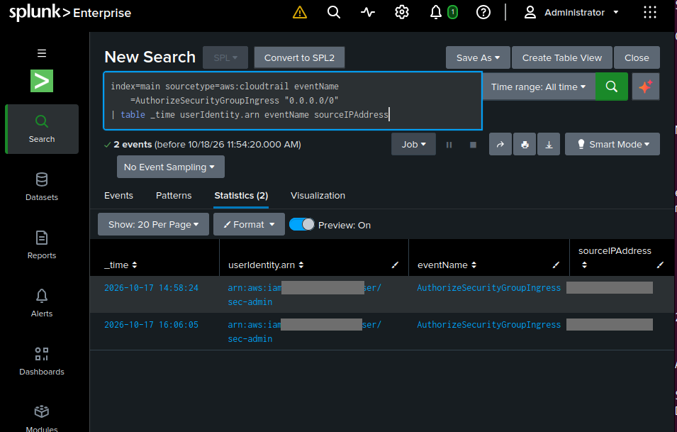 |
| DET-02 | S3 bucket policy / public access block changes | T1530 | 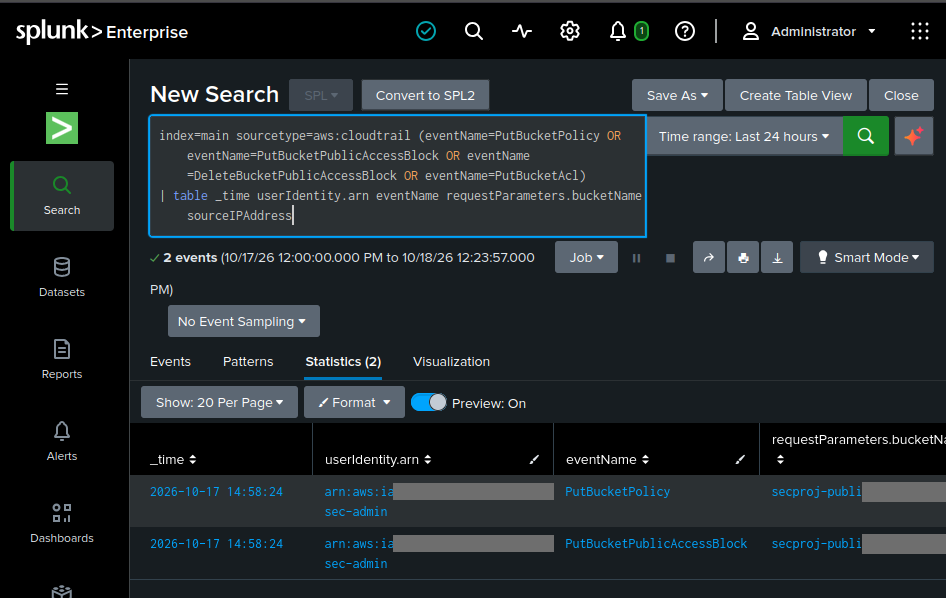 |
| DET-03 | IAM role, policy, user or access key creation | T1098 | 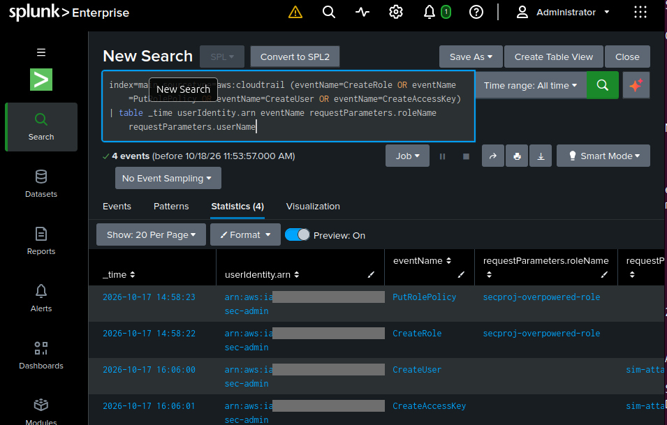 |
| DET-04 | CloudTrail logging stopped or modified | T1562.008 | 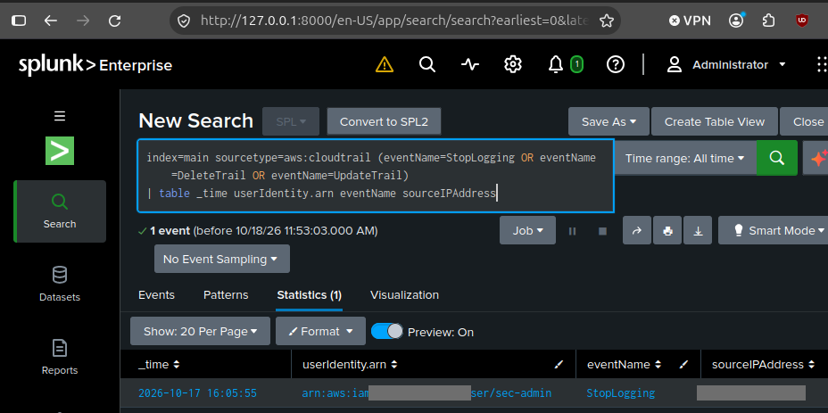 |
| DET-05 | Root account usage | T1078.004 | 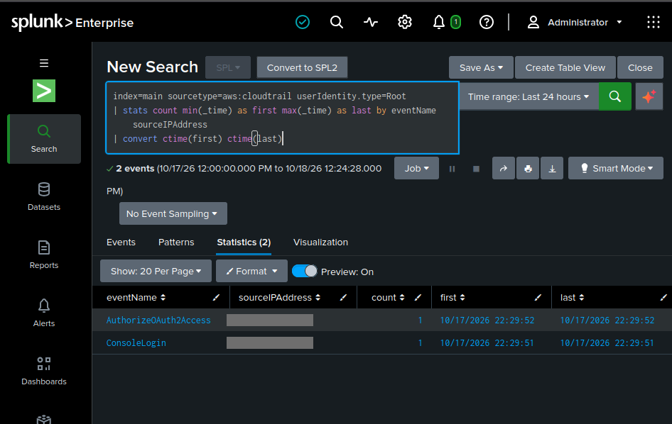 |
| DET-06 | Console login without MFA | T1078.004 | 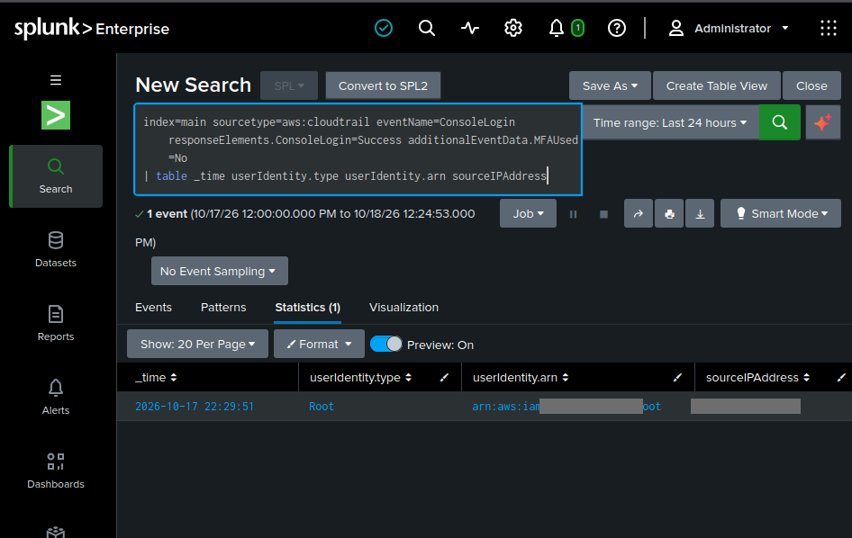 |
| DET-07 | Failed console logins | T1110 | 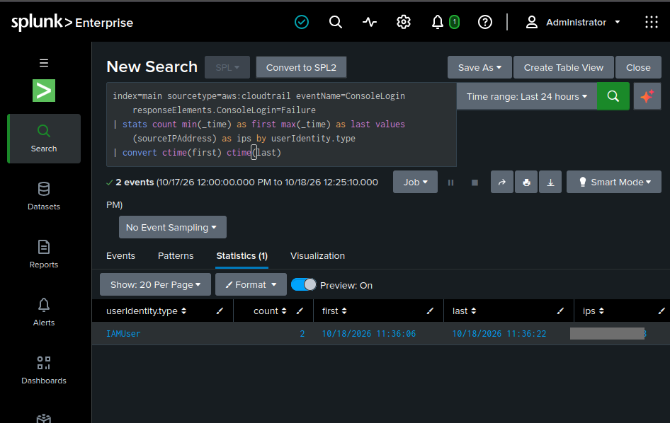 |

Dashboard:

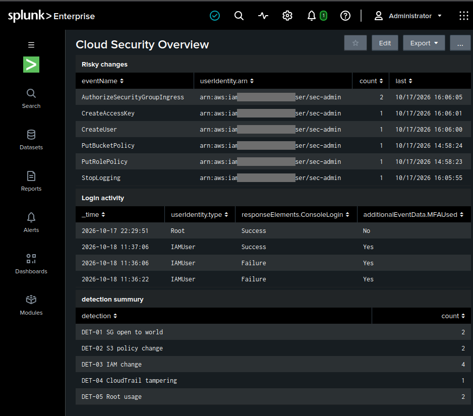

## 3. Attack simulation

[`scripts/simulate_attacks.sh`](scripts/simulate_attacks.sh) replays what an intruder would do after getting access:

1. Stop and restart CloudTrail (hide tracks) → DET-04
2. Create a user and an access key (persistence) → DET-03
3. Open a security group to the internet → DET-01

All three appeared in Splunk. The simulation used the same `sec-admin` identity, so the actor in the logs is `sec-admin`; a real attacker would show a different identity, but the detected behaviours are the same.

## 4. Findings

Monitoring and a Prowler scan surfaced these issues:

| # | Finding | Severity | Why it matters | Recommendation |
|---|---|---|---|---|
| 1 | S3 bucket readable by anyone (public policy, Block Public Access off) | High | Data exposure | Enable all four Block Public Access settings, remove public policy |
| 2 | Security group allows SSH from `0.0.0.0/0` | High | Exposes remote access to the internet | Restrict to a trusted CIDR or remove the rule |
| 3 | IAM role with `Action: *` on `Resource: *` | High | Privilege escalation, full account takeover if the role is compromised | Least-privilege policy scoped to required actions and resources |
| 4 | Root user signed in without MFA | High | Root compromise = total account compromise | Enable MFA on root, avoid daily root use |
| 5 | Bucket without default encryption | Medium | Data at rest unprotected | Enable SSE-S3 or KMS |
| 6 | `sec-admin` has `AdministratorAccess` | Medium | Over-privileged daily account | Split admin and daily roles |

Prowler before remediation:

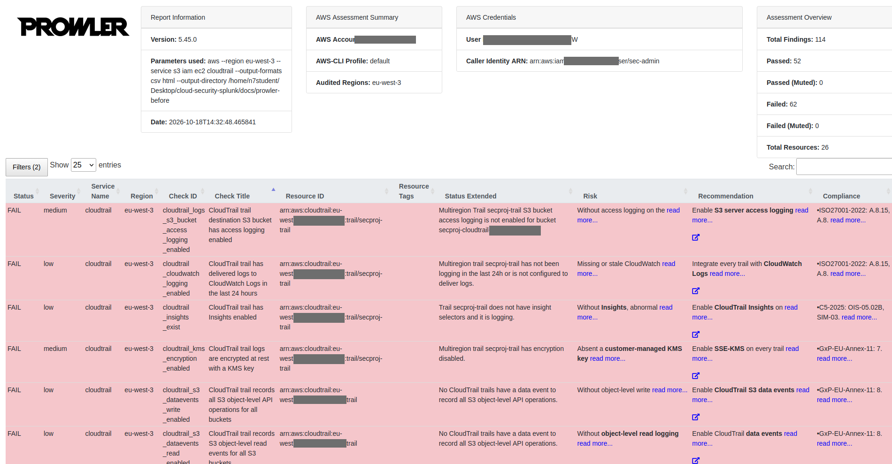
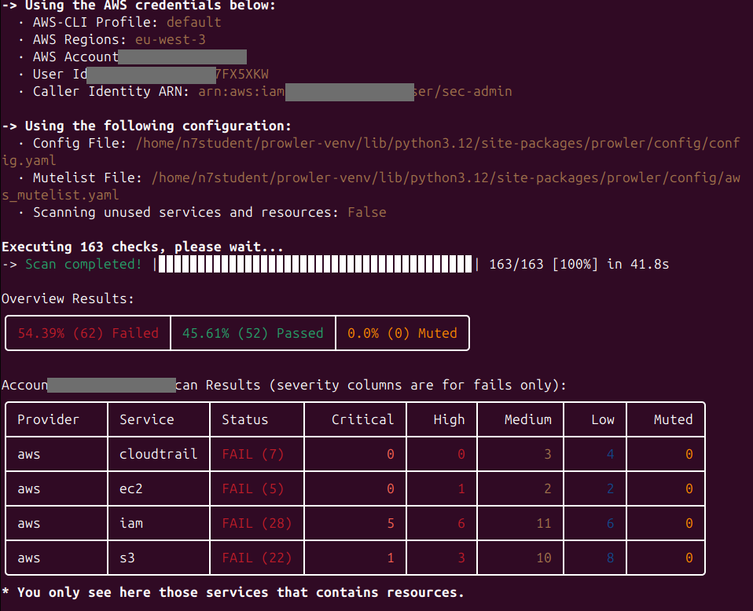

## 5. Remediation

The fixes are in Terraform (the original weak configuration is kept in [`docs/main.vulnerable.tf.txt`](docs/main.vulnerable.tf.txt)):

- Bucket: Block Public Access on, public policy removed, AES256 encryption
- Security group: no inbound rules
- IAM role: read-only access to one bucket
- Simulation leftovers deleted (`sim-attacker`, test security group)
- Root MFA enabled in the console


| | Before | After |
|---|---|---|
| Prowler FAIL findings | 62 | **TODO_AFTER** |
| Public bucket | `IsPublic: true` | policy removed |
| SSH from `0.0.0.0/0` | yes | no inbound rules |

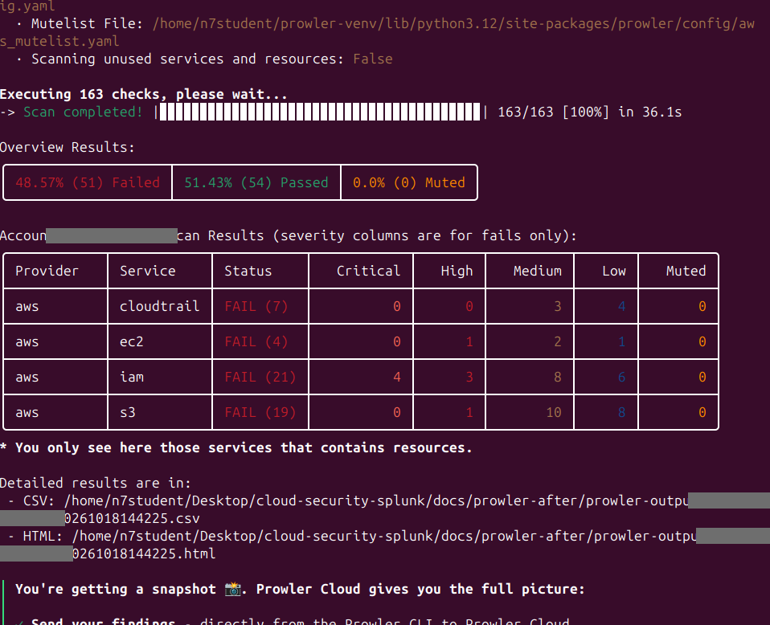

Remaining findings (KMS keys, lifecycle rules, MFA Delete, admin policy on `sec-admin`) are accepted for this lab and would be addressed in production.

## 6. Limitations and next steps

- Ingestion is **batch** (script run manually), not real time. Next: Splunk Add-on for AWS reading S3 or SQS, or a cron job.
- GuardDuty was not enabled because the new account returned a subscription error.
- DET-07 has no threshold (a production rule would alert on N failures in M minutes).
- Detections are saved as scheduled alerts in Splunk; adding notification actions (email, webhook) is the next step.
- Everything was done in a throwaway sandbox account; the first sign-ins used root without MFA, which is itself a finding (DET-05, DET-06).

## 7. Reproduce

```bash
cd terraform/logging && terraform init && terraform apply
cd ../vulnerable && terraform init && terraform apply
cd ../../splunk && cp .env.example .env && docker compose up -d
../scripts/refresh_logs.sh
```

Never commit `.env`, `*.tfstate*`, or the `logs/` folders. Account IDs and public IPs are blurred in all screenshots.

## 8. Security watch

Sources followed while building this: AWS Security Blog, CISA advisories, MITRE ATT&CK for Cloud, Splunk Security Content. *(Keep this line only if true.)*
